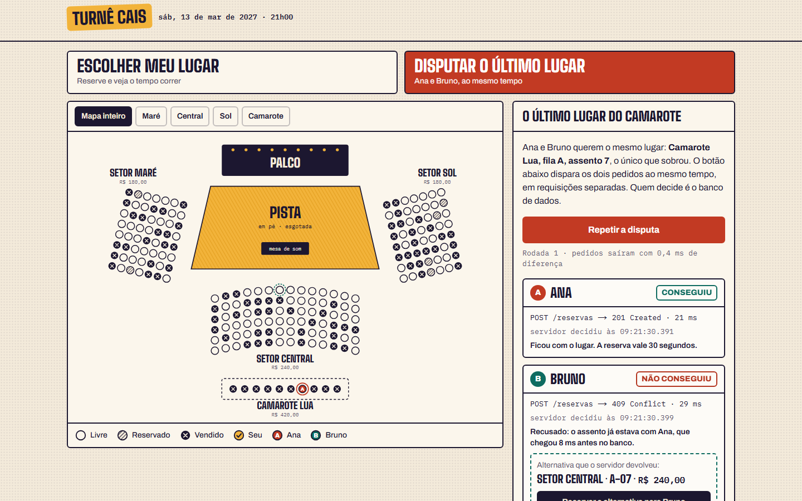
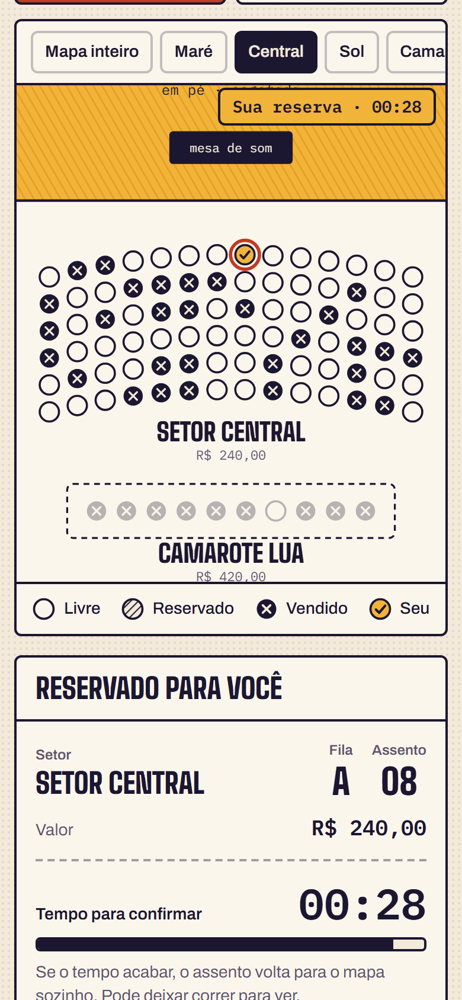

# Último Ingresso

Bilheteria de show com mapa de assentos, reserva com contagem regressiva e uma disputa ao vivo pelo último lugar. Quem decide a disputa é o PostgreSQL.

**Experimente:** https://ultimo-ingresso.vercel.app





## Os dois caminhos

- **Escolher meu lugar**: toque num assento livre e reserve por 30 segundos. O relógio corre na tela e no mapa. Confirme a compra para receber o ingresso digital, ou deixe o tempo acabar e veja o assento voltar a ficar livre.
- **Disputar o último lugar**: Ana e Bruno pedem o único assento livre do Camarote ao mesmo tempo, em duas requisições independentes. A tela mostra quem conseguiu (201), a recusa do outro (409), quantos milissegundos separaram os dois no banco e a alternativa que o servidor devolveu. Dá para repetir quantas vezes quiser.

Cada visitante ganha uma sessão própria, com o show inteiro só para ele: a disputa de um não mexe no mapa de outro. Nenhum pagamento é processado.

## Rodar

Com Docker (app e banco):

```bash
docker compose up --build
```

Abra http://localhost:3000. As migrações e os dados iniciais rodam sozinhos quando o app sobe.

Para desenvolver:

```bash
npm install
npm run db                    # sobe só o Postgres, na porta 55433
cp .env.example .env.local
npm run dev
```

## Testes

```bash
npm run db
npm test
```

Os testes de integração rodam contra um PostgreSQL de verdade (o banco `ultimo_ingresso_teste`, recriado a cada execução):

- duas tentativas simultâneas pelo mesmo assento produzem exatamente uma reserva, em 40 rodadas seguidas;
- vinte compradores ao mesmo tempo: um consegue, dezenove recebem 409;
- o mesmo pedido enviado duas vezes (clique duplo) vira uma reserva só;
- duas confirmações simultâneas emitem um único ingresso;
- confirmar uma reserva vencida devolve 410 e libera o assento;
- sessões diferentes não interferem uma na outra.

Com o servidor rodando, `npm run verificar` percorre os dois caminhos no navegador, no computador e no celular, e salva capturas em `capturas/`.

A versão publicada roda na Vercel (região de São Paulo) com banco no Neon; cada push no `main` publica de novo.

O CI (GitHub Actions) roda lint, checagem de tipos, os testes com um serviço PostgreSQL, o build e o build da imagem Docker.

## Como a reserva duplicada é evitada

A regra mora no banco, não no código da aplicação:

```sql
CREATE UNIQUE INDEX reservas_uma_valida_por_assento
  ON reservas (sessao_id, evento_id, assento_id)
  WHERE status IN ('ativa', 'confirmada');
```

1. **Reservar** é um `INSERT ... ON CONFLICT DO NOTHING`. Não existe "ler se está livre e depois gravar", então não há janela de corrida. Se Ana e Bruno inserem ao mesmo tempo, o Postgres faz a segunda transação esperar a primeira; quando a primeira confirma, a segunda não grava nada e a API responde 409 com o dono atual e um assento livre parecido.
2. **Clique duplo**: cada pedido leva uma chave, com índice único por sessão. Repetir a chave devolve a mesma reserva.
3. **Confirmar** é um `UPDATE ... WHERE status = 'ativa' AND expira_em > now()`. A linha fica travada durante a transação; a segunda confirmação espera, encontra a reserva já confirmada e recebe o mesmo ingresso. A tabela de ingressos tem `reserva_id` único.
4. **Expiração**: o prazo vem do relógio do banco. Reservas vencidas viram "expiradas" (e saem do índice) antes de cada tentativa no mesmo assento, a cada leitura do mapa e a cada ciclo do canal de tempo real. Confirmar depois do prazo devolve 410.

Para conferir que o teste principal pega a corrida: sem o índice, Ana e Bruno conseguem o mesmo assento e o teste falha.

## Arquitetura

Um app Next.js só: a interface e a API (route handlers) no mesmo servidor Node, com PostgreSQL via `pg`.

| Rota | O que faz |
| --- | --- |
| `POST /api/sessoes` | Cria a sessão do visitante, com o público já sentado |
| `GET /api/sessoes/:sessao/mapa` | Estado de todos os assentos |
| `GET /api/sessoes/:sessao/eventos` | Tempo real (Server-Sent Events): manda o mapa quando alguma reserva muda |
| `POST /api/sessoes/:sessao/reservas` | Reserva: 201, 200 (pedido repetido) ou 409 |
| `POST /api/sessoes/:sessao/reservas/:id/confirmacao` | Compra: 201, 200 (já confirmada) ou 410 |
| `DELETE /api/sessoes/:sessao/reservas/:id` | Desiste da reserva |
| `POST /api/sessoes/:sessao/disputa` | Libera o último lugar para uma nova rodada |
| `POST /api/sessoes/:sessao/reinicio` | Volta a sessão ao estado inicial |

O canal de tempo real compara a cada 700 ms uma assinatura do estado da sessão e só manda o mapa quando ela muda. Não depende de processo em segundo plano.

No mapa, cada estado tem forma própria, além da cor: livre é um círculo vazado, reservado é hachurado, vendido é cheio com um X, e o seu assento leva um visto. Os assentos funcionam pelo teclado (setas e Enter) e têm descrição para leitor de tela.

Código principal: regras em `src/servidor/reservas.ts`, esquema em `src/servidor/esquema.ts`, testes em `testes/`.
